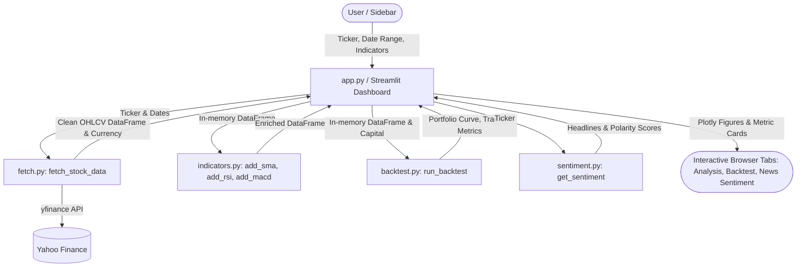

# Stock Analyzer Dashboard

An interactive web application for stock market technical analysis, SMA crossover backtesting, and real-time news sentiment scoring built with Python and Streamlit.

**Live App:** [Click here to open the app](https://stock-analyzer-z45hcwnwbx9t6bztjbdzon.streamlit.app/)

---

## What It Does

- **Live Market Data:** Fetches historical and real-time stock price data from Yahoo Finance for any valid ticker worldwide (e.g., `AAPL`, `MSFT`, `GOOG`, or Indian equities like `RELIANCE.NS`).
- **Technical Indicators:** Computes key technical indicators from scratch using pandas with guaranteed input immutability:
  - **SMA (Simple Moving Average):** 20-day and 50-day moving averages.
  - **RSI (Relative Strength Index, 14-day):** Wilder's smoothed RSI with robust handling of flat prices and extreme runs.
  - **MACD (Moving Average Convergence Divergence):** 12/26 EMA line, 9 EMA signal line, and difference histogram.
- **SMA Crossover Backtesting Engine:** Evaluates a quantitative momentum strategy directly in-memory against a buy-and-hold benchmark, tracking cash, shares, trade signals, and total portfolio valuation over time.
- **News Sentiment Analysis:** Retrieves recent company headlines from Yahoo Finance and performs NLP sentiment analysis using TextBlob to classify headlines as Positive, Negative, or Neutral.
- **Interactive Multi-Pane Charts:** Responsive Plotly visualizations for synchronized indicator tracking and trade entry/exit overlay.

---

## Tech Stack

| Component | Library / Tool | Purpose |
|-----------|----------------|---------|
| Language | Python 3.11+ / 3.12 | Core language |
| Web Framework | Streamlit | Reactive dashboard and sidebar controls |
| Financial Data | yfinance | Live OHLCV market feeds and news headlines |
| Data Processing | pandas & numpy | Time-series manipulation and indicator formulas |
| Visualizations | Plotly | Dynamic multi-pane technical charts and equity curves |
| Sentiment NLP | TextBlob | Rule-based NLP headline polarity and subjectivity scoring |
| Test Suite | pytest | Automated unit and integration tests |

---

## Architecture & Data Flow



1. **Sidebar inputs** (ticker symbol, date boundaries, indicator toggles, initial capital) are sanitized and validated.
2. `fetch.py` handles communication with Yahoo Finance, returns standardized OHLCV DataFrames, and extracts native currency metadata.
3. `indicators.py` generates new indicator series non-destructively on DataFrame copies.
4. `backtest.py` executes signal detection, portfolio simulation, and metric aggregation directly in memory with zero CSV side effects.
5. `sentiment.py` fetches recent news, computes TextBlob polarity scores, and classifies headlines using centralized threshold constants.
6. `app.py` organizes output into three dedicated tabs: **Analysis**, **Backtest**, and **News Sentiment**.

---

## How to Run Locally

### 1. Clone the repository
```bash
git clone https://github.com/yasshi7233/Stock-analyzer.git
cd Stock-analyzer
```

### 2. Create and activate a virtual environment

**On Windows (PowerShell):**
```powershell
python -m venv .venv
.\.venv\Scripts\Activate.ps1
```

**On Windows (Command Prompt):**
```cmd
python -m venv .venv
.\.venv\Scripts\activate.bat
```

**On macOS / Linux:**
```bash
python3 -m venv .venv
source .venv/bin/activate
```

### 3. Install dependencies
```bash
pip install -r requirements.txt
```

### 4. Run the Streamlit dashboard
```bash
streamlit run app.py
```

### 5. Run the automated test suite
```bash
pytest -v
```

---

## Project Structure

```text
Stock-analyzer/
├── app.py              # Main Streamlit dashboard (tabs, sidebar controls, caching)
├── backtest.py         # SMA crossover backtest engine and reusable Plotly chart
├── fetch.py            # Centralized Yahoo Finance data-fetching layer with currency detection
├── indicators.py       # Technical indicator formulas (SMA, Wilder's RSI, MACD)
├── sentiment.py        # News sentiment analysis and headline polarity classification
├── plot_indicators.py  # Standalone CLI script for plotting technical indicators
├── run_backtest.py     # Standalone CLI script for executing a quick backtest
├── requirements.txt    # Pinned core dependencies
├── .gitignore          # Git exclusions (.venv, *.csv, caches)
├── README.md           # Documentation and setup instructions
├── test_app.py         # Tests for app input cleaning and date validation
├── test_backtest.py    # Tests for backtesting logic, returns, trade logs, and warm-up
├── test_indicators.py  # Tests for SMA, Wilder's RSI, MACD, and immutability
└── test_sentiment.py   # Tests for headline parsing, sentiment scoring, and fallbacks
```

---

## Suggested Screenshots

To showcase the application visually in portfolios or documentation, the following genuine UI captures are recommended:
1. **Technical Analysis Tab (`screenshot_analysis.png`):** The primary view showing the top metric cards (Latest Close with currency, Period High/Low, Avg Volume) and the synchronized multi-pane Plotly chart displaying Price, SMA 20/50, RSI (14) with 30/70 thresholds, and the MACD histogram.
2. **Backtest Tab (`screenshot_backtest.png`):** The strategy evaluation view displaying the Initial Capital, Final Value, Strategy Return %, Buy-and-Hold Return %, the interactive equity curve with green/red trade markers, and the trade log table.
3. **News Sentiment Tab (`screenshot_sentiment.png`):** The sentiment view displaying overall sentiment summary badges, the headline sentiment distribution bar chart, and individual sentiment cards.

---

## Limitations & Disclaimers

- **Long-Only Strategy:** The built-in crossover engine only executes long positions (holding 100% cash or 100% equity). It does not model short selling, leverage, or fractional rebalancing.
- **Transaction Costs & Slippage:** Backtest calculations currently assume zero brokerage commissions, zero exchange fees, and execution exactly at the daily close price without slippage.
- **Past Performance:** Historical backtesting results do not guarantee future market returns.
- **Data Source Dependencies:** Market quotes and headline feeds rely on Yahoo Finance APIs, which may experience occasional rate limits, delayed quotes, or news schema updates.
- **NLP Sentiment Scope:** Headline sentiment is evaluated using TextBlob's lexical polarity dictionary; it does not account for complex financial jargon, sarcasm, or full article body text.

---

*Built by [Yashi], 2026*